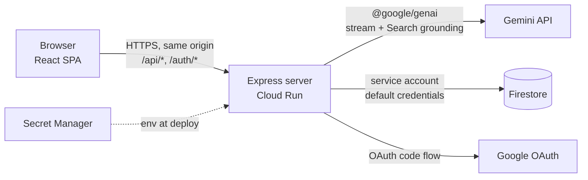
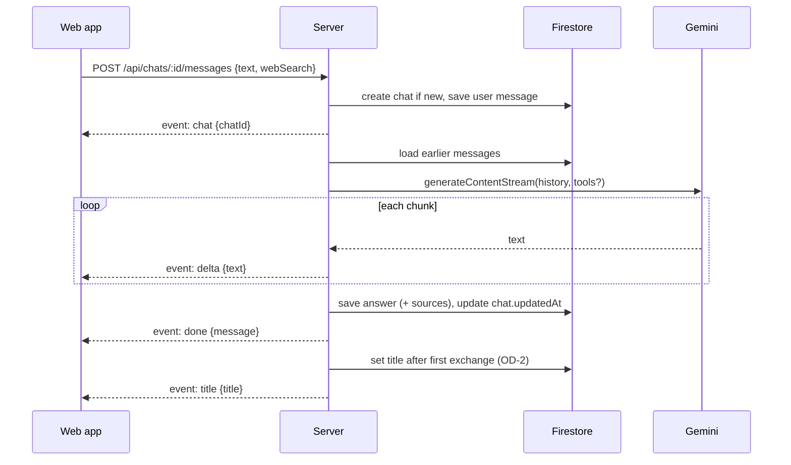

# Architecture — brAIn

How the app in `docs/PRD.md` is built: modules, data, APIs and the main flows. Requirements are
referenced as `FR-n`, open questions as `OD-n` (see `docs/ROADMAP.md`). Stack choices and their
reasons are recorded in `docs/adr/` once it exists.

## 1. Overview

One container on Google Cloud Run runs an Express 5 server. It serves the built React app and a
JSON/SSE API on the same origin, so there is no CORS and the session cookie never leaves the site.



- The browser only ever talks to our server. API keys, OAuth secrets and cloud credentials stay
  on the server (PRD §6 Security).
- The server is stateless between requests: sessions, chats and messages live in Firestore, so
  any instance can answer any request and instances can scale to zero.

## 2. Workspaces and modules

| Workspace         | Package         | Role                                                 |
| ----------------- | --------------- | ---------------------------------------------------- |
| `apps/server`     | `@brain/server` | Express app: auth, API, Gemini calls, static hosting |
| `apps/web`        | `@brain/web`    | React SPA built with Vite                            |
| `packages/shared` | `@brain/shared` | Types shared by both: API bodies, SSE events, models |

`packages/shared` holds types and small pure helpers only, no runtime dependencies, so it can be
imported by both sides without pulling server code into the browser.

### 2.1 Server (`apps/server/src`)

| Module   | Responsibility                                                                                                                  |
| -------- | ------------------------------------------------------------------------------------------------------------------------------- |
| `config` | Reads and validates environment variables at startup; fails fast if one is wrong.                                               |
| `app`    | Builds the Express app: middleware order, routers, static files, error handler.                                                 |
| `auth`   | Google OAuth flow, device sessions, the `requireSession` / `requireUnlocked` middleware, PIN set/change/unlock.                 |
| `chats`  | Chat and message routes, plus the Firestore repository for them.                                                                |
| `gemini` | Thin wrapper over `@google/genai`: builds the request, streams text, extracts sources. Behind an interface so tests use a fake. |
| `store`  | Creates the Firestore client (emulator in development).                                                                         |
| `index`  | Entry point: loads `config`, builds `app`, listens on `PORT`.                                                                   |

Routes depend on repositories and the Gemini client through constructor arguments (plain
function parameters), not module imports, so unit tests can pass in fakes.

### 2.2 Web (`apps/web/src`)

| Module    | Responsibility                                                                                                                     |
| --------- | ---------------------------------------------------------------------------------------------------------------------------------- |
| `api`     | Typed `fetch` wrappers and the SSE reader for answers. Turns `401` into a redirect to `/sign-in` and `locked` into the PIN screen. |
| `session` | Session state (`needs-pin`, `locked`, `unlocked`), the idle timer and the PIN screens.                                             |
| `chat`    | Chat view: message list, Markdown rendering, composer, web search toggle, retry.                                                   |
| `sidebar` | Chat list, new chat, delete with confirmation; collapsible on small screens.                                                       |
| `routes`  | React Router: `/sign-in`, `/` (new chat), `/c/:chatId`.                                                                            |

Server state (chat list, messages) is cached with TanStack Query. A streaming answer is kept in
local component state while it arrives, then the query cache is updated with the saved message.

## 3. Data model (Firestore)

```text
chats/{chatId}
  title: string | null          # set after the first exchange (OD-2)
  createdAt: Timestamp
  updatedAt: Timestamp          # last message; sidebar sorts by this, newest first
  webSearch?: boolean           # only if the toggle is per chat (OD-3)

chats/{chatId}/messages/{messageId}
  role: 'user' | 'model'
  text: string
  status: 'complete' | 'error'
  error?: { code: string, message: string }
  sources?: { title: string, url: string }[]   # from Search grounding (FR-14)
  webSearch: boolean            # whether search was on for this answer
  createdAt: Timestamp

devices/{sha256(sessionToken)}
  createdAt: Timestamp
  expiresAt: Timestamp          # createdAt + 15 days (FR-3)
  lastActiveAt: Timestamp       # for the 30-minute lock (FR-3a)
  failedPins: number            # reset on success; 3 → device deleted
  userAgent: string             # to tell devices apart

settings/owner
  pinHash: string | null        # scrypt hash with salt and parameters
```

- A chat document is created only when its first message is sent (FR-10).
- Deleting a chat deletes the document and its `messages` subcollection with
  `Firestore.recursiveDelete` (FR-12).
- A message is written once it is complete: the user message before calling Gemini, the answer
  after the stream ends (FR-8). A failed answer is saved with `status: 'error'` so the chat shows
  it and offers a retry (FR-7).
- The device document ID is a hash of the cookie token, so a leaked database export can't be
  used to sign in.

## 4. Authentication, sessions and lock

### 4.1 Sign in (FR-1, FR-3)

1. `GET /auth/google` sets a short-lived `state` cookie and redirects to Google's consent screen
   (scopes `openid email`).
2. Google redirects to `GET /auth/google/callback`. The server checks `state`, exchanges the code
   for tokens, verifies the ID token and requires `email_verified` and
   `email === ALLOWED_EMAIL`.
3. On a match it creates a random 256-bit session token, stores `devices/{hash}` and sets the
   cookie `__Host-session` (`HttpOnly`, `Secure`, `SameSite=Lax`, `Path=/`, `Max-Age` 15 days).
   On a mismatch it redirects to `/sign-in?error=denied` and stores nothing.
4. It redirects to `/`. If no PIN is set yet, the app shows the set-PIN screen.

`SameSite=Lax` (not `Strict`) is needed because the redirect back from Google is a cross-site
navigation. State-changing requests are additionally protected by checking the `Origin` header
against the app's own origin and only accepting `application/json` bodies.

### 4.2 Request guard (FR-2, OD-4)

Every request except `/auth/*`, `/sign-in` and static assets passes through `requireSession`:

| Condition                            | Page load (`GET` HTML)   | API call (`/api/*`)            |
| ------------------------------------ | ------------------------ | ------------------------------ |
| No cookie, unknown or expired device | `302` to `/sign-in`      | `401`; app goes to `/sign-in`  |
| Signed in, no PIN set yet            | serve app; shows set-PIN | `403 { code: 'pin-required' }` |
| Signed in, idle > 30 min (locked)    | serve app; shows PIN     | `403 { code: 'locked' }`       |
| Signed in and unlocked               | serve app                | handled                        |

The server is the authority on the lock: a device is locked when
`now - lastActiveAt > 30 min`. Each handled API request updates `lastActiveAt` (written at most
once a minute to save writes). The web app also runs its own 30-minute idle timer on user input
so it locks the screen even without requests, and sends a throttled `POST /api/session/ping` on
input so that reading or typing keeps the server-side session awake.

### 4.3 PIN (FR-3a)

- Hashed with Node's built-in `crypto.scrypt` and a random salt; compared with
  `crypto.timingSafeEqual`. No extra dependency.
- `POST /api/session/unlock` checks the PIN. Success resets `failedPins` and `lastActiveAt`.
  The third failure in a row deletes the device and clears the cookie.
- "Forgot PIN" and "Sign out" both delete the device and clear the cookie. After the next Google
  sign-in, "Forgot PIN" lets the owner set a new PIN (the old hash is cleared when Forgot PIN is
  used).

## 5. Chat flow (FR-4 – FR-7, FR-13, FR-14)

Answers stream to the browser as Server-Sent Events over the response of a `POST` (OD-1).



- **New chat.** The web app generates no ID; it posts to `/api/chats/new/messages` and the
  server answers with the new `chatId` in the first event, after which the app moves to
  `/c/:chatId`.
- **Events.** `chat`, `delta`, `sources`, `done`, `title`, `error`. Their types live in
  `@brain/shared`.
- **History.** The server rebuilds the Gemini `contents` from the saved messages on every turn;
  no chat state is kept in memory. If the history is too long, the oldest turns are dropped to
  fit a token budget (FR-6). Messages with `status: 'error'` are left out.
- **Web search.** When on, the request includes the `googleSearch` tool; when off, it has no
  tools (FR-13). Sources come from the response's grounding metadata and are saved on the answer
  (FR-14).
- **Errors.** Gemini failures, timeouts and quota errors become an `error` event with a code
  the app can show, and an error message is saved. `POST /api/chats/:id/retry` runs the last
  user message again (FR-7).
- **Leaving mid-answer.** If the browser disconnects (chat switched, app locked, tab closed),
  the server keeps reading the Gemini stream and still saves the answer (FR-11, FR-3a). See §9
  for the Cloud Run caveat.

## 6. HTTP API

All bodies are JSON unless noted. All `/api/*` routes need a signed-in, unlocked device unless
marked otherwise.

| Method & path                  | Purpose                                                                        |
| ------------------------------ | ------------------------------------------------------------------------------ |
| `GET /auth/google`             | Start Google sign-in (public)                                                  |
| `GET /auth/google/callback`    | Finish sign-in, set cookie (public)                                            |
| `POST /auth/sign-out`          | Delete device, clear cookie (signed in)                                        |
| `GET /api/session`             | `{ state: 'needs-pin' \| 'locked' \| 'unlocked' }` (signed in, any lock state) |
| `POST /api/session/pin`        | Set the PIN when none is set (signed in)                                       |
| `POST /api/session/unlock`     | `{ pin }` → unlock (signed in, locked)                                         |
| `POST /api/session/forgot-pin` | Sign out and clear the PIN (signed in)                                         |
| `PUT /api/session/pin`         | `{ currentPin, newPin }` → change the PIN                                      |
| `POST /api/session/ping`       | Keep the session active                                                        |
| `GET /api/chats`               | Chat list, newest first                                                        |
| `GET /api/chats/:id`           | One chat with all its messages                                                 |
| `POST /api/chats/:id/messages` | Send a message; response is `text/event-stream` (`:id` may be `new`)           |
| `POST /api/chats/:id/retry`    | Retry the last failed answer; `text/event-stream`                              |
| `DELETE /api/chats/:id`        | Delete a chat and its messages                                                 |
| `GET /*` (anything else)       | The SPA's `index.html`, after the guard in §4.2                                |

## 7. Configuration

Read by the `config` module; examples go in `.env.example` as each one is first used.

| Variable                  | Purpose                                           | Production source |
| ------------------------- | ------------------------------------------------- | ----------------- |
| `NODE_ENV`, `PORT`        | Runtime mode, listen port                         | Cloud Run         |
| `PUBLIC_URL`              | App origin; OAuth redirect URL and `Origin` check | env               |
| `ALLOWED_EMAIL`           | The owner's Google account                        | env               |
| `GOOGLE_CLIENT_ID`        | OAuth client                                      | env               |
| `GOOGLE_CLIENT_SECRET`    | OAuth client secret                               | Secret Manager    |
| `GEMINI_API_KEY`          | Gemini API key                                    | Secret Manager    |
| `GEMINI_MODEL`            | Model name, e.g. a Flash model                    | env               |
| `GOOGLE_CLOUD_PROJECT`    | Firestore project                                 | Cloud Run         |
| `FIRESTORE_EMULATOR_HOST` | Use the local emulator (development only)         | —                 |

## 8. Development, testing and deployment

- **Local.** `vite` serves the web app with hot reload and proxies `/api` and `/auth` to the
  Express server, which runs with `tsx watch` against the Firestore emulator. Google sign-in
  works locally with an OAuth client that allows `http://localhost` redirects.
- **Tests.** Vitest, as today. Server route tests use `supertest`-style requests against the
  Express app with a fake Gemini client and the Firestore emulator (or an in-memory fake
  repository). Web tests use jsdom and Testing Library. No test calls the real Gemini API.
- **Build.** `npm run build` builds `@brain/web` to `apps/web/dist` and `@brain/server` to
  `apps/server/dist`; the server serves the web build as static files.
- **Container.** A multi-stage `Dockerfile`: install and build, then copy only `dist` folders and
  production dependencies into a `node:24-slim` image that runs `node apps/server/dist/index.js`.
- **Cloud Run.** Its own service account with Firestore access (`roles/datastore.user`) and
  access to the two secrets. Request timeout raised (e.g. 5 minutes) so long answers can finish.
  Minimum instances 0; the performance target in PRD §6 allows for a cold start.

## 9. Risks and open points

- **Answers after a disconnect.** With Cloud Run's default "CPU only during requests", an
  instance may be throttled once the browser disconnects, which can stall the rest of an answer.
  Options: turn on CPU always allocated, or accept the small risk for a single user. Decide when
  FR-11 is built.
- **OD-2 (titles).** Either option fits the flow in §5: the title is set after the first `done`
  event, from the first message or from an extra, short Gemini call.
- **OD-3 (search toggle scope).** The request always carries `webSearch`; if it is per chat, the
  chat document stores it too.
- **OD-5 (spending cap).** If a cap is chosen, it is a check in the `chats` routes before calling
  Gemini, with a counter document in Firestore.
- **Post-MVP memory.** Vector search over memories and axioms can use Firestore vector search, so
  it can live in the same database. It would add a module next to `chats` that adds context
  before the Gemini call.
