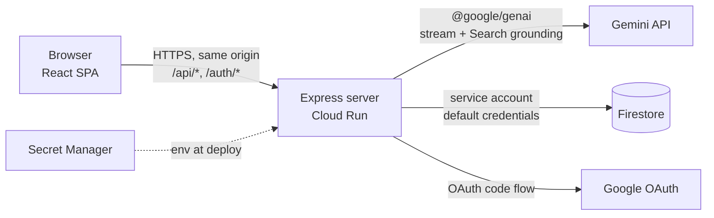
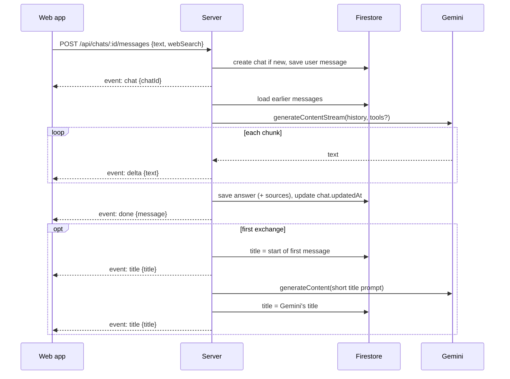

# Architecture — brAIn

How the app in `docs/PRD.md` is built: modules, data, APIs and the main flows. Requirements are
referenced as `FR-n`, open questions as `OD-n` (see `docs/ROADMAP.md`). Stack choices and their
reasons are recorded in `docs/adr/`.

## 1. Overview

One container on Google Cloud Run runs an Express 5 server. It serves the built React app and a
JSON/SSE API on the same origin, so there is no CORS and the session cookie never leaves the site.



- The browser only ever talks to our server. API keys, OAuth secrets and cloud credentials stay
  on the server (PRD §6 Security).
- The server is stateless between requests: sessions, chats and messages live in Firestore, so
  any instance can answer any request and instances can scale to zero.

## 2. Workspaces and modules

| Workspace         | Package         | Role                                                 |
| ----------------- | --------------- | ---------------------------------------------------- |
| `apps/server`     | `@brain/server` | Express app: auth, API, Gemini calls, static hosting |
| `apps/web`        | `@brain/web`    | React SPA built with Vite                            |
| `packages/shared` | `@brain/shared` | Types shared by both: API bodies, SSE events, models |

`packages/shared` holds types and small pure helpers only, no runtime dependencies, so it can be
imported by both sides without pulling server code into the browser.

Its `exports` point TypeScript at `src/` and runtime imports at `dist/`, so typecheck and lint
need no build step. Vitest and Vite alias it to `src/` as well, so the browser bundle is built
from source. Node, running the built server, loads
`dist/`, so `npm run build` builds `packages/*` before `apps/*` (the order of `workspaces` in the
root `package.json`). Type-only imports are erased and need no build.

### 2.1 Server (`apps/server/src`)

| Module   | Responsibility                                                                                                                  |
| -------- | ------------------------------------------------------------------------------------------------------------------------------- |
| `config` | Reads and validates environment variables at startup; fails fast if one is wrong.                                               |
| `app`    | Builds the Express app: middleware order, routers, static files, error handler.                                                 |
| `auth`   | Google OAuth flow, device sessions, the `requireSession` / `requireUnlocked` middleware, PIN set/change/unlock.                 |
| `chats`  | Chat and message routes, plus the Firestore repository for them.                                                                |
| `import` | Parses a Gemini Markdown export into a title, source link and turns (pure function); the import route saves it as a chat.       |
| `gemini` | Thin wrapper over `@google/genai`: builds the request, streams text, extracts sources. Behind an interface so tests use a fake. |
| `store`  | Creates the Firestore client (emulator in development).                                                                         |
| `index`  | Entry point: loads `config`, builds `app`, listens on `PORT`.                                                                   |

Routes depend on repositories and the Gemini client through constructor arguments (plain
function parameters), not module imports, so unit tests can pass in fakes.

### 2.2 Web (`apps/web/src`)

| Module    | Responsibility                                                                                                                     |
| --------- | ---------------------------------------------------------------------------------------------------------------------------------- |
| `api`     | Typed `fetch` wrappers and the SSE reader for answers. Turns `401` into a redirect to `/sign-in` and `locked` into the PIN screen. |
| `session` | Session state (`needs-pin`, `locked`, `unlocked`), the idle timer and the PIN screens.                                             |
| `chat`    | Chat view: message list, Markdown rendering, composer, web search toggle, retry, "Imported from Gemini" note with link.            |
| `sidebar` | Chat list, new chat, import chat, delete with confirmation; collapsible on small screens.                                          |
| `routes`  | React Router: `/sign-in`, `/` (new chat), `/c/:chatId`.                                                                            |

Server state (chat list, messages) is cached with TanStack Query. A streaming answer is kept in
local component state while it arrives, then the query cache is updated with the saved message.

## 3. Data model (Firestore)

```text
chats/{chatId}
  title: string | null          # set after the first exchange (§5)
  createdAt: Timestamp
  updatedAt: Timestamp          # last message; sidebar sorts by this, newest first
  importedFrom?: { kind: 'gemini-markdown', url: string | null }   # imported chats (FR-15)

chats/{chatId}/messages/{messageId}
  role: 'user' | 'model'
  text: string
  status: 'complete' | 'error'
  error?: { code: string, message: string }
  sources?: { title: string, url: string }[]   # from Search grounding (FR-14)
  webSearch: boolean            # whether search was on for this message (FR-13)
  createdAt: Timestamp

devices/{sha256(sessionToken)}
  createdAt: Timestamp
  expiresAt: Timestamp          # createdAt + 15 days (FR-3)
  lastActiveAt: Timestamp       # for the 30-minute lock (FR-3a)
  failedPins: number            # reset on success; 3 → device deleted
  userAgent: string             # to tell devices apart

settings/owner
  pinHash: string | null        # scrypt hash with salt and parameters
```

- A chat document is created only when its first message is sent (FR-10).
- Deleting a chat deletes the document and its `messages` subcollection with
  `Firestore.recursiveDelete` (FR-12).
- A message is written once it is complete: the user message before calling Gemini, the answer
  after the stream ends (FR-8). A failed answer is saved with `status: 'error'` so the chat shows
  it and offers a retry (FR-7).
- An imported chat uses the same documents as any other chat; only `importedFrom` is extra
  (§5.1).
- The device document ID is a hash of the cookie token, so a leaked database export can't be
  used to sign in.

## 4. Authentication, sessions and lock

### 4.1 Sign in (FR-1, FR-3)

1. `GET /auth/google` sets a random `state` in the cookie `__Host-oauth-state` (10 minutes) and
   redirects to Google's consent screen (scopes `openid email`, account chooser shown).
2. Google redirects to `GET /auth/google/callback`. The server checks `state` against the cookie
   (and clears it), exchanges the code for tokens, verifies the ID token and requires
   `email_verified` and `email === ALLOWED_EMAIL` (ignoring case).
3. On a match it creates a random 256-bit session token, stores `devices/{hash}` and sets the
   cookie `__Host-session` (`HttpOnly`, `Secure`, `SameSite=Lax`, `Path=/`, `Max-Age` 15 days).
   On a mismatch it redirects to `/sign-in?error=denied` and stores nothing. A bad or missing
   `state`, a missing code (sign-in cancelled on Google) or a failed code exchange redirects to
   `/sign-in?error=failed`.
4. It redirects to `/`. If no PIN is set yet, the app shows the set-PIN screen.

Each sign-in creates a new device, so other devices stay signed in. Browsers accept `Secure`
cookies from `http://localhost`, so the same cookies work in development.

`SameSite=Lax` (not `Strict`) is needed because the redirect back from Google is a cross-site
navigation. State-changing requests (anything but `GET`, `HEAD`, `OPTIONS`) are additionally
protected: the `Origin` header must equal `PUBLIC_URL` (else `403 { code: 'bad-origin' }`), and a
request with a `Content-Type` or a body must be `application/json` (else
`415 { code: 'json-required' }`), which a cross-site HTML form can't send. A request without a
body, like a bodyless `fetch`, passes.

### 4.2 Request guard (FR-2, OD-4)

Every request except `/auth/*`, `/sign-in` and static assets passes through `requireSession`:

| Condition                            | Page load (`GET` HTML)   | API call (`/api/*`)                                  |
| ------------------------------------ | ------------------------ | ---------------------------------------------------- |
| No cookie, unknown or expired device | `302` to `/sign-in`      | `401 { code: 'signed-out' }`; app goes to `/sign-in` |
| Signed in, no PIN set yet            | serve app; shows set-PIN | `403 { code: 'pin-required' }`                       |
| Signed in, idle > 30 min (locked)    | serve app; shows PIN     | `403 { code: 'locked' }`                             |
| Signed in and unlocked               | serve app                | handled                                              |

The server is the authority on the lock: a device is locked when
`now - lastActiveAt > 30 min`. Each handled API request updates `lastActiveAt` (written at most
once a minute to save writes). The web app also runs its own 30-minute idle timer on user input
so it locks the screen even without requests, and sends a throttled `POST /api/session/ping` on
input so that reading or typing keeps the server-side session awake.

### 4.3 PIN (FR-3a)

- Hashed with Node's built-in `crypto.scrypt` and a random salt; compared with
  `crypto.timingSafeEqual`. No extra dependency.
- `POST /api/session/unlock` checks the PIN. Success resets `failedPins` and `lastActiveAt`.
  The third failure in a row deletes the device and clears the cookie.
- "Sign out" deletes this device and clears the cookie.
- "Forgot PIN" clears the PIN hash, deletes **every** device and clears this device's cookie.
  After the next Google sign-in the owner sets a new PIN. Deleting all devices matters: a device
  left signed in would see "no PIN set" and offer to set one, which would let whoever holds it
  past the lock without a Google sign-in.

## 5. Chat flow (FR-4 – FR-7, FR-13, FR-14)

Answers stream to the browser as Server-Sent Events over the response of a `POST` (OD-1).



- **New chat.** The web app generates no ID; it posts to `/api/chats/new/messages` and the
  server answers with the new `chatId` in the first event, after which the app moves to
  `/c/:chatId`.
- **Events.** `chat`, `delta`, `sources`, `done`, `title`, `error`. Their types live in
  `@brain/shared`. The server closes the stream after the title step, or after `done` when there
  is no title step. The web app reads until the server closes it: `done` means the answer is
  saved, not that the stream is over.
- **History.** The server rebuilds the Gemini `contents` from the saved messages on every turn;
  no chat state is kept in memory. If the history is too long, the oldest turns are dropped to
  fit a token budget (FR-6). Messages with `status: 'error'` are left out.
- **Title.** After the first answer is saved, the chat's title is set to the first user
  message, on one line, cut at a word boundary to about 60 characters. The server then asks
  Gemini for a 3–6 word title from the first message and answer, without search. If that call
  succeeds and returns a non-empty title (trimmed, at most 80 characters), it replaces the
  first one. If it fails, the first title stays and no error is shown. The web app shows
  whichever `title` event came last. A failed first answer still gets the first title.
- **Web search.** The toggle is per message: the web app sends `webSearch` with each message
  and turns the toggle off after sending (FR-13). Nothing is stored on the chat. When on, the
  request includes the `googleSearch` tool; when off, it has no tools. Sources come from the
  response's grounding metadata and are saved on the answer (FR-14). A retry uses the
  `webSearch` value of the message it retries.
- **Errors.** Gemini failures, timeouts and quota errors become an `error` event with a code
  the app can show, and an error message is saved. `POST /api/chats/:id/retry` runs the last
  user message again (FR-7).
- **Leaving mid-answer.** If the browser disconnects (chat switched, app locked, tab closed),
  the server keeps reading the Gemini stream and still saves the answer (FR-11, FR-3a). See §9
  for the Cloud Run caveat and what the app shows if an answer is lost.

### 5.1 Import a chat (FR-15)

1. The sidebar's "Import chat" opens a file picker (`accept=".md"`). The app reads the file
   with `File.text()` and checks its size. If Google Docs downloads a `.zip` (it does when the
   doc has images), the owner unzips it and picks the `.md` file inside.
2. It sends `POST /api/chats/import { markdown }`. The file travels as JSON, not as a multipart
   upload, so the `Origin` + JSON rule from §4.1 still protects the route and no upload library
   is needed.
3. The server parses the text with the `import` module, saves the chat and answers
   `201 { chatId }`. The app refreshes the chat list and opens `/c/:chatId`.

No Gemini call is made. After the import the chat is an ordinary chat: the next message goes
through the flow in §5, and the history sent to Gemini includes the imported turns.

**Parser.** A pure function, `parseGeminiExport(markdown)`, returns
`{ title, url, turns: { prompt, response }[] }` or a format error. It expects what Google Docs
writes when a Gemini "Export to Docs" document is downloaded as Markdown:

```text
# **Chat title**

[https\://gemini.google.com/app/…](https://gemini.google.com/app/…)

*User prompt: first question*

Response: first answer, in Markdown…

---

*User prompt: second question*

Response: …

---
```

- Line endings are normalised to `\n` and a leading BOM is dropped.
- **Title:** the first `# ` heading, with the surrounding `**` removed. Required.
- **Link:** the first link to `https://gemini.google.com/` before the first turn. Optional.
- **Turns:** a turn starts at a line beginning `*User prompt: `. The prompt runs to the closing
  `*`, which may be on a later line. The answer starts after `Response: ` and runs to a `---`
  line that is followed by the next turn or the end of the file, so a `---` inside an answer is
  kept.
- **Tolerances:** the prompt may be wrapped in `_` instead of `*` (Prettier and some editors
  rewrite one to the other), and trailing whitespace on the prompt, `Response:` and `---` lines
  is ignored. Nothing else is loosened.
- **Escapes:** Google Docs escapes Markdown characters (`\:`, `\.`, `\+`, `\=`). They are
  removed from the title and prompts, which are shown as plain text. Answers are kept as
  written, because a Markdown renderer already shows the escapes correctly.
- **Strict:** if the file has no title or no turns, or a turn has an empty prompt or no
  `Response:`, the whole file is rejected with `400 { code: 'import-format' }` and the number
  of the turn that failed. An unexpected file, or a change in Google's export format, fails
  loudly instead of saving a broken chat. The parser is then updated for the new format.

**Saving.**

- The chat gets `title` from the heading, `importedFrom: { kind: 'gemini-markdown', url }`,
  and `createdAt` / `updatedAt` set to the import time, so it shows first in the sidebar. The
  title step from §5 is skipped.
- Each turn becomes a `user` and a `model` message with `status: 'complete'`,
  `webSearch: false` and no `sources` (the export has none). The export has no timestamps, so
  the messages get the import time plus 1 ms per message, which keeps them in order.
- Firestore batches hold at most 500 writes, so messages are written in batches and the chat
  document goes in the last one. A chat with no chat document is never listed, so a failed
  import doesn't show. On failure the server deletes what was written with `recursiveDelete`.
- **Size:** at most 1 MB of Markdown, checked by the app before sending and by the server
  (`413 { code: 'import-too-large' }`). This keeps every message well under Firestore's 1 MiB
  document limit. The import route's JSON body limit is raised to match; other routes keep the
  default.

## 6. HTTP API

All bodies are JSON unless noted. All `/api/*` routes need a signed-in, unlocked device unless
marked otherwise.

| Method & path                  | Purpose                                                                        |
| ------------------------------ | ------------------------------------------------------------------------------ |
| `GET /api/health`              | `{ status: 'ok' }` (public)                                                    |
| `GET /auth/google`             | Start Google sign-in (public)                                                  |
| `GET /auth/google/callback`    | Finish sign-in, set cookie (public)                                            |
| `POST /auth/sign-out`          | Delete device, clear cookie (signed in)                                        |
| `GET /api/session`             | `{ state: 'needs-pin' \| 'locked' \| 'unlocked' }` (signed in, any lock state) |
| `POST /api/session/pin`        | Set the PIN when none is set (signed in)                                       |
| `POST /api/session/unlock`     | `{ pin }` → unlock (signed in, locked)                                         |
| `POST /api/session/forgot-pin` | Clear the PIN and sign out every device (signed in)                            |
| `PUT /api/session/pin`         | `{ currentPin, newPin }` → change the PIN                                      |
| `POST /api/session/ping`       | Keep the session active                                                        |
| `GET /api/chats`               | Chat list, newest first                                                        |
| `GET /api/chats/:id`           | One chat with all its messages                                                 |
| `POST /api/chats/:id/messages` | Send a message; response is `text/event-stream` (`:id` may be `new`)           |
| `POST /api/chats/:id/retry`    | Retry the last failed answer; `text/event-stream`                              |
| `POST /api/chats/import`       | `{ markdown }` → `201 { chatId }`; import a Gemini export (§5.1)               |
| `DELETE /api/chats/:id`        | Delete a chat and its messages                                                 |
| `GET /*` (anything else)       | The SPA's `index.html`, after the guard in §4.2                                |

## 7. Configuration

Read by the `config` module; examples go in `.env.example` as each one is first used.

| Variable                  | Purpose                                           | Production source |
| ------------------------- | ------------------------------------------------- | ----------------- |
| `NODE_ENV`                | Runtime mode                                      | `Dockerfile`      |
| `PORT`                    | Listen port                                       | Cloud Run         |
| `PUBLIC_URL`              | App origin; OAuth redirect URL and `Origin` check | env               |
| `ALLOWED_EMAIL`           | The owner's Google account                        | env               |
| `GOOGLE_CLIENT_ID`        | OAuth client                                      | env               |
| `GOOGLE_CLIENT_SECRET`    | OAuth client secret                               | Secret Manager    |
| `GEMINI_API_KEY`          | Gemini API key                                    | Secret Manager    |
| `GEMINI_MODEL`            | Model name: `gemini-3.8-flash` (quota set, §8)    | env               |
| `GOOGLE_CLOUD_PROJECT`    | Firestore project                                 | env               |
| `FIRESTORE_EMULATOR_HOST` | Emulator `host:port`; rejected in production      | —                 |

## 8. Development, testing and deployment

- **Local.** `vite` (`npm run dev:web`) serves the web app with hot reload and proxies `/api`
  and `/auth` to the Express server (`npm run dev`, on `PORT` from `.env`), which runs with
  `tsx watch` against the Firestore emulator (`npm run emulator`, project `demo-brain`, port
  8081; setup in `docs/development.md`). Google sign-in works locally with an OAuth client
  that allows `http://localhost` redirects.
- **Tests.** Vitest, as today. Server route tests use `supertest`-style requests against the
  Express app with a fake Gemini client and the Firestore emulator (or an in-memory fake
  repository). Tests that need the emulator skip under plain `npm test`;
  `npm run test:emulator` starts it, runs every test and stops it. CI always runs that, so the
  emulator tests never skip there (ADR-0018). Web tests use jsdom and Testing Library. No test calls the real Gemini API.
  The import parser is tested against made-up fixture files in the Gemini export format, not
  the owner's real chats.
- **Build.** `npm run build` builds `@brain/web` to `apps/web/dist` and `@brain/server` to
  `apps/server/dist`. With `NODE_ENV=production` the server serves the web build as static files
  and answers any other `GET` outside `/api` and `/auth` with its `index.html` (SPA fallback).
- **Container.** A multi-stage `Dockerfile`: install and build, then copy only `dist` folders and
  production dependencies into a `node:24-slim` image that runs `node apps/server/dist/index.js`.
  Cloud Build builds it on deploy (`gcloud run deploy --source .`), so no local Docker is needed.
- **Deploy.** By hand, from an up-to-date `main` after CI passes; steps and rollback are in
  `docs/deploy.md`.
- **Cloud Run.** Its own service account with Firestore access (`roles/datastore.user`) and
  access to the two secrets. Request timeout raised (e.g. 5 minutes) so long answers can finish.
  Minimum instances 0; the performance target in PRD §6 allows for a cold start. Billing stays
  request-based (CPU only during requests), see §9.
- **Spending limits (PRD §6 Cost).** Set in the Google Cloud console, not in the app:
  - a monthly budget on the billing account with email alerts at 50%, 90% and 100%. It covers
    the whole project, but only warns and never stops spending. The owner's existing
    all-projects budget on the billing account serves; it is shared with their other projects;
  - lowered request quotas on the Gemini API (`generativelanguage.googleapis.com`, once shown as
    "Generative Language API") for the project. This is the hard stop, and it also holds if the
    API key leaks. Set values:
    - `generate_content_requests`: **10 per minute**, project-wide, every model and tier;
    - `generate_requests_per_model_per_day`: **300 per day** for `gemini-3.8-flash`. This quota
      exists only per model, so it must be set again if `GEMINI_MODEL` changes.

  Gemini then answers with a quota error, which becomes an `error` event like any other (§5,
  FR-7). Commands are in `docs/deploy.md`.

## 9. Risks and open points

- **Answers after a disconnect.** With Cloud Run's default "CPU only during requests", an
  instance may be throttled once the browser disconnects, which can stall the rest of an answer
  (and the title call after it). Accepted for a single user: billing stays request-based. If an
  answer is lost this way, the chat ends with a user message and no answer. The web app treats
  a last user message older than the request timeout (§8) as a failed answer and offers a retry
  (FR-7). If this happens often, switch the service to instance-based billing (CPU always
  allocated); no code changes.
- **Spending.** There is no in-app cap: the budget alert and API quota in §8 limit spending. An
  in-app daily counter (a Firestore document checked before each Gemini call) can be added
  later if a clearer in-app limit is wanted.
- **Import format.** Google's export format is not documented and can change. The strict parser
  (§5.1) makes a change show up as an import error, not as a broken chat.
- **Lock gaps (post-MVP).** Locking is by idle time only. A closed tab doesn't lock, so
  reopening within 30 minutes goes straight in, and there is no "Lock now" button. Planned fix:
  a correct PIN returns a random unlock token that the app keeps in `sessionStorage` (cleared
  when the tab closes) and sends with each API call; the device record stores its hash, and a
  device is unlocked only with that token and less than 30 minutes idle. "Lock now" then
  deletes the token. A `pagehide` request was ruled out: mobile browsers often don't fire it.
- **Post-MVP memory.** Vector search over memories and axioms can use Firestore vector search, so
  it can live in the same database. It would add a module next to `chats` that adds context
  before the Gemini call.
